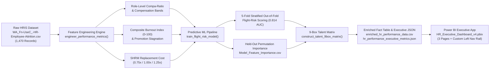

# STRATEGIC TALENT & PERFORMANCE INTELLIGENCE MEMORANDUM

**TO:** Chief Human Resources Officer (CHRO), Executive Compensation Committee, & VP of People Operations  
**FROM:** Senior HR Performance & People Analytics Lead  
**DATE:** November 2026  
**SUBJECT:** Enterprise Performance Audit, Regrettable Attrition Economics & Predictive Flight-Risk Strategy  
**DELIVERABLES:** [`HR_Executive_Dashboard_v4.pbix`](file:///d:/ME/port/hr/HR_Executive_Dashboard_v4.pbix) | [`performance_analytics.py`](file:///d:/ME/port/hr/performance_analytics.py) | [`hr_performance_executive_metrics.json`](file:///d:/ME/port/hr/hr_performance_executive_metrics.json)  

---

## 1. Executive Summary

An enterprise-wide diagnostic of **1,470 employee records** (`1,233` active personnel and `237` historical departures across **Research & Development**, **Sales**, and **Human Resources**) was conducted to evaluate the efficacy of our **Pay-for-Performance framework**, quantify the financial drain of **regrettable turnover**, and deploy an **out-of-fold machine learning flight-risk architecture**.

### Headline Executive Scorecard

| Strategic Metric | Verified Value | Target / Benchmark | Executive Diagnostic |
| :--- | :--- | :--- | :--- |
| **Enterprise Workforce Headcount** | **1,470** (`1,233` Active) | — | 83.88% active retention across 3 departments and 9 job roles |
| **Overall Attrition Rate** | **16.12%** (`237` exits) | 10.0% – 12.0% | Exceeds industry benchmark by +412 bps; concentrated in Years 0–2 (`29.82%`) |
| **Total Turnover Replacement Cost** | **\$12,327,384** | < \$7.5M | Cumulative SHRM-modeled replacement drain (\$52,014 avg per exit) |
| **Regrettable Turnover Financial Loss** | **\$6,458,949** (`87` exits) | < \$2.0M | **52.40%** of total dollar loss stems from the **36.71%** of exits classified as key/top talent |
| **Unadjusted Base Pay Gap (Rating 4 vs. 3)** | **-\$188.50 / mo** (`-3.8%`) | +15.0% to +25.0% | Rating 4 median (\$4,777.00) lags Rating 3 (\$4,965.50) due to earlier-tenure band mix |
| **Within-Band Compa-Ratio Parity** | **1.01** (R4) vs. **1.03** (R3) | $\ge 1.10$ for Rating 4 | **Zero Merit Premium:** Top performers sit at peer median (`1.00`) despite +7.85% higher hikes |
| **Top Talent Retention Advantage** | **-0.29%** (`-0.3%` displayed) | +5.0% to +8.0% | Rating 4 attrition (**16.37%**) is slightly worse than Rating 3 (**16.08%**) |
| **Underpaid Active Top Talent (`<0.85` CR)** | **30 Employees** | 0 Employees | Paid **25.5% below role/level median** (`0.745` avg CR); **\$1,577,340** replacement exposure |
| **Market Parity Recalibration Budget** | **\$400,968 / yr** | **3.93× Direct ROI** | Annual pool required to lift all 30 underpaid top performers to `1.00` Compa-Ratio |
| **Active Top Talent Flight-Risk Exposure** | **\$684,780** (`15` personnel) | \$0 | `1` Critical Target (\$15,780) + `14` Moderate Watchlist (\$669,000) in active Rating 4 cohort |
| **Predictive Model Discrimination** | **0.814 ROC-AUC** (RF) | > 0.750 | Validated alongside a **0.837 ROC-AUC** regularized Logistic Regression baseline |

> [!IMPORTANT]
> **Core Strategic Finding — The "Merit Hike Mirage":** While the organization awards outstanding performers (`PerformanceRating = 4`) a **21.85%** average salary hike compared to **14.00%** for core contributors (`PerformanceRating = 3`), those percentage increases are applied to compressed starting base salaries (`0.745` average Compa-Ratio among the 30 most underpaid top performers). Consequently, top performers achieve **no structural pay premium within their job role and level (`1.01` vs. `1.03` Compa-Ratio)** and exhibit **zero retention advantage (`16.37%` vs. `16.08%` attrition)**.

---

## 2. System & Analytical Architecture

The end-to-end solution integrates an automated Python feature-engineering and machine learning pipeline ([`performance_analytics.py`](file:///d:/ME/port/hr/performance_analytics.py)) with an executive 3-page Power BI application ([`HR_Executive_Dashboard_v4.pbix`](file:///d:/ME/port/hr/HR_Executive_Dashboard_v4.pbix)):

---

## 3. Pillar I: Turnover Economics & Regrettable Attrition Audit (Dashboard Page 1)

### 3.1 SHRM Replacement Cost Methodology
To translate headcount turnover into P&L impact, each employee record is assigned an estimated replacement cost (`EstimatedReplacementCost`) based on Society for Human Resource Management (SHRM) benchmark multipliers applied to annualized base pay:

$$\text{EstimatedReplacementCost}_i = \text{MonthlyIncome}_i \times 12 \times \text{Multiplier}_i$$

* **Top Performers (`PerformanceRating = 4`)**: **1.25× Annual Base Salary** (executive/technical search fees, lost domain IP, extended ramp time).
* **Senior & Managerial Personnel (`JobLevel` 3–5, `PerformanceRating = 3`)**: **1.00× Annual Base Salary**.
* **Junior & Mid-Level Contributors (`JobLevel` 1–2, `PerformanceRating = 3`)**: **0.75× Annual Base Salary**.

### 3.2 Regrettable vs. Non-Regrettable Turnover Split
Departures (`Attrition = "Yes"`, `237` exits) are segmented into three strategic categories:

| Attrition Category | Qualification Criteria | Exits | Share of Exits | Replacement Cost | Share of Total Cost | Avg Cost / Exit |
| :--- | :--- | :---: | :---: | :---: | :---: | :---: |
| **Regrettable Attrition (Top Performer)** | `PerformanceRating = 4` | 37 | 15.61% | \$2,750,385 | 22.31% | \$74,335 |
| **Regrettable Attrition (Core Talent)** | `Rating = 3`, `JobInvolvement >= 3`, `JobLevel >= 2` | 50 | 21.10% | \$3,708,564 | 30.08% | \$74,171 |
| **Subtotal: Total Regrettable Attrition** | **Key & Top-Tier Talent Losses** | **87** | **36.71%** | **\$6,458,949** | **52.40%** | **\$74,241** |
| **Non-Regrettable / Standard Attrition** | All other `Attrition = "Yes"` exits | 150 | 63.29% | \$5,868,435 | 47.60% | \$39,123 |
| **Enterprise Total** | **All Historical Departures** | **237** | **100.00%** | **\$12,327,384** | **100.00%** | **\$52,014** |

> [!NOTE]
> Although regrettable departures account for **36.71%** of exit headcount (`87` of `237` leavers), they drive **52.40%** (**\$6,458,949**) of total financial drain because each regrettable departure costs an average of **\$74,241** to replace—nearly **1.9×** the cost of a standard departure (**\$39,123**).

### 3.3 Departmental & Job Role Turnover Cost Concentration

| Department | Total Headcount | Active | Departed | Attrition Rate | Total Turnover Cost | Share of Total Cost |
| :--- | :---: | :---: | :---: | :---: | :---: | :---: |
| **Research & Development** | 961 | 828 | 133 | 13.84% | **\$5,992,791** | **48.61%** |
| **Sales** | 446 | 354 | 92 | 20.63% | **\$5,859,558** | **47.53%** |
| **Human Resources** | 63 | 51 | 12 | 19.05% | **\$475,035** | **3.85%** |
| **Enterprise Total** | **1,470** | **1,233** | **237** | **16.12%** | **\$12,327,384** | **100.00%** |

#### Granular Job Role Cost & Risk Breakdown
| Job Role | Headcount | Exits | Attrition Rate | Total Turnover Cost | Cost Share | Active Underpaid R4 (`<0.85` CR) |
| :--- | :---: | :---: | :---: | :---: | :---: | :---: |
| **Sales Executive** | 326 | 57 | 17.5% | **\$4,626,324** | 37.53% | 5 |
| **Laboratory Technician** | 259 | 62 | 23.9% | **\$1,889,403** | 15.33% | 7 |
| **Research Scientist** | 292 | 47 | 16.1% | **\$1,370,586** | 11.12% | 7 |
| **Manager** | 102 | 5 | 4.9% | **\$1,007,844** | 8.18% | 0 |
| **Healthcare Representative** | 131 | 9 | 6.9% | **\$915,636** | 7.43% | 3 |
| **Manufacturing Director** | 145 | 10 | 6.9% | **\$807,858** | 6.55% | 2 |
| **Sales Representative** | 83 | 33 | **39.8%** | **\$769,206** | 6.24% | 2 |
| **Human Resources** | 52 | 12 | 23.1% | **\$475,035** | 3.85% | 3 |
| **Research Director** | 80 | 2 | 2.5% | **\$465,492** | 3.78% | 1 |

### 3.4 The Overtime Multiplier & Early-Career "Retention Cliff"

1. **OverTime × Department Attrition Disparity**:
   Across every business unit, employees working mandatory or frequent overtime (`OverTime = "Yes"`) resign at nearly **3× the rate** of non-overtime peers (**30.53%** vs. **10.44%**):
   * **Sales**: **37.50%** with OverTime (`48/128`) vs. **13.84%** without OverTime (`44/318`) — **2.71× multiplier**.
   * **Research & Development**: **27.31%** with OverTime (`74/271`) vs. **8.55%** without OverTime (`59/690`) — **3.19× multiplier**.
   * **Human Resources**: **29.41%** with OverTime (`5/17`) vs. **15.22%** without OverTime (`7/46`) — **1.93× multiplier**.

2. **Lifecycle Tenure "Retention Cliff" (`YearsAtCompany`)**:
   * **0–2 Years (Onboarding / Early Career)**: `342` employees, **`102` exits (`29.82%` attrition rate)**, costing **\$3,583,896** (`43.0%` of all enterprise exits occur within the first 24 months; `34.3%` in Years 0–1).
   * **3–5 Years (Mid-Tenure)**: `434` employees, `60` exits (**13.82%** attrition rate), costing **\$2,613,093**.
   * **6–10 Years (Established)**: `448` employees, `55` exits (**12.28%** attrition rate), costing **\$3,380,904**.
   * **11+ Years (Veteran)**: `246` employees, `20` exits (**8.13%** attrition rate), costing **\$2,749,491**.

---

## 4. Pillar II: Pay-for-Performance & Meritocracy Audit (Dashboard Page 2)

### 4.1 Enterprise Compensation & Appraisal Calibration Table

The appraisal system exhibits severe **rating compression**, with 100% of employees rated either `3` ("Excellent" / Core) or `4` ("Outstanding" / Top):

| Audit Dimension | Rating 3 (Core Contributor) | Rating 4 (Outstanding Performer) | Variance (R4 vs. R3) | Diagnostic Interpretation |
| :--- | :---: | :---: | :---: | :--- |
| **Total Headcount** | 1,244 (84.63%) | 226 (15.37%) | — | Compressed 2-tier appraisal distribution |
| **Active / Departed Headcount** | 1,044 Active / 200 Exits | 189 Active / 37 Exits | — | — |
| **Median Monthly Base Income** | **\$4,965.50** | **\$4,777.00** | **-\$188.50 (-3.80%)** | Unadjusted base lag due to earlier-career cohort mix |
| **Mean Monthly Base Income** | \$6,537.27 | \$6,313.89 | -\$223.38 (-3.42%) | Mean base pay lag persists across the enterprise |
| **Average Salary Hike %** | 14.00% | **21.85%** | **+7.85% (+785 bps)** | Strong annual percentage merit differentiation |
| **Median Salary Hike %** | 14.00% | **22.00%** | **+8.00% (+800 bps)** | Consistent with arithmetic mean hike |
| **Role-Level Compa-Ratio** | **1.03** | **1.01** | **-0.02 (-2.0%)** | **Absence of Within-Band Premium** for top talent |
| **Average Stock Option Level** | 0.79 | 0.80 | +0.01 | Equity grants are not differentiated by performance |
| **Historical Attrition Rate** | **16.08%** | **16.37%** | **+0.29% (-0.3% edge)** | **Zero retention advantage for Rating 4 talent** |

### 4.2 Compensation Band Distribution by Performance Rating

$$\text{CompaRatio}_i = \frac{\text{MonthlyIncome}_i}{\text{Median}(\text{MonthlyIncome}_{\text{JobRole}, \text{JobLevel}})}$$

| Compensation Band | Rating 3 Total (Active / Exits) | Rating 3 Share | Rating 4 Total (Active / Exits) | Rating 4 Share |
| :--- | :---: | :---: | :---: | :---: |
| **Under-Market (`< 0.85` CR)** | 259 (212 Active / 47 Exits) | 20.82% | **39 (30 Active / 9 Exits)** | **17.26%** |
| **Market-Competitive (`0.85 – 1.15` CR)** | 704 (590 Active / 114 Exits) | 56.59% | 149 (131 Active / 18 Exits) | 65.93% |
| **Above-Market (`> 1.15` CR)** | 281 (242 Active / 39 Exits) | 22.59% | 38 (28 Active / 10 Exits) | 16.81% |
| **Total** | **1,244 (1,044 Active / 200 Exits)** | **100.00%** | **226 (189 Active / 37 Exits)** | **100.00%** |

> [!WARNING]
> **The 30 Underpaid Active Top Performers (`PerformanceRating = 4`, `CompaRatio < 0.85`, `Attrition = "No"`)**:
> Exactly **30 active Rating 4 employees** earn strictly below `0.85` of their exact role-and-level peer median, with an average Compa-Ratio of **0.745** (**25.5% below peer parity**). Losing this cohort to external competitors represents **\$1,577,340** in replacement cost exposure.

### 4.3 Market Parity Recalibration Investment Bridge (`1.00` Compa-Ratio Target)

To eliminate within-band pay compression for all **30 underpaid active top performers**, we modeled the exact annual salary adjustment required to lift each individual to `1.00` Compa-Ratio parity (`(RoleLevelMedianIncome - MonthlyIncome) * 12`):

| Department / Job Role | Underpaid Active R4 Count | Avg Compa-Ratio | Annual Recalibration Budget (`to 1.00 CR`) | Share of Pool | Protected Replacement Exposure | Direct ROI Multiple |
| :--- | :---: | :---: | :---: | :---: | :---: | :---: |
| **Research & Development (Subtotal)** | **20** | **0.748** | **\$255,324** | **63.68%** | **\$1,038,960** | **4.07×** |
| ├── Laboratory Technician | 7 | 0.741 | \$64,218 | 16.02% | \$254,955 | 3.97× |
| ├── Research Scientist | 7 | 0.752 | \$62,328 | 15.54% | \$204,960 | 3.29× |
| ├── Healthcare Representative | 3 | 0.739 | \$67,056 | 16.72% | \$236,130 | 3.52× |
| ├── Manufacturing Director | 2 | 0.768 | \$35,712 | 8.91% | \$177,450 | 4.97× |
| └── Research Director | 1 | 0.762 | \$26,010 | 6.49% | \$165,465 | 6.36× |
| **Sales (Subtotal)** | **7** | **0.739** | **\$101,304** | **25.26%** | **\$373,815** | **3.69×** |
| ├── Sales Executive | 5 | 0.758 | \$68,484 | 17.08% | \$323,445 | 4.72× |
| └── Sales Representative | 2 | 0.692 | \$32,820 | 8.19% | \$50,370 | 1.53× |
| **Human Resources (Subtotal)** | **3** | **0.737** | **\$44,340** | **11.06%** | **\$164,565** | **3.71×** |
| └── Human Resources | 3 | 0.737 | \$44,340 | 11.06% | \$164,565 | 3.71× |
| **Enterprise Recalibration Total** | **30** | **0.745** | **\$400,968** | **100.00%** | **\$1,577,340** | **3.93×** |

* **Phased Implementation Option**: An immediate Stage 1 floor adjustment lifting all 30 employees to the `0.85` Compa-Ratio band threshold requires **\$126,700/yr** (**12.45× ROI**), followed by a Stage 2 mid-year adjustment of **\$274,268/yr** to reach full `1.00` peer median parity (**\$400,968/yr** combined).

---

## 5. Pillar III: Predictive Flight-Risk & 9-Box Talent Matrix (Dashboard Page 3)

### 5.1 Predictive Model Architecture & Top Attrition Drivers
In [`train_flight_risk_model`](file:///d:/ME/port/hr/performance_analytics.py#L145-L211), a `RandomForestClassifier` (`n_estimators = 150`, `max_depth = 6`) and an L2-regularized `LogisticRegression` baseline (`StandardScaler` + `class_weight = 'balanced'`) are evaluated via stratified cross-validation:
* **Held-Out Test ROC-AUC**: **0.814** (Random Forest) | **0.837** (Logistic Regression Baseline).
* **Out-of-Fold Workforce Scoring**: 5-fold `StratifiedKFold` `cross_val_predict` generates leak-free probability scores ($p \in [0.0, 1.0]$) across all 1,470 employees.

#### Top 10 Predictive Drivers of Attrition ([`Model_Feature_Importance.csv`](file:///d:/ME/port/hr/Model_Feature_Importance.csv))
| Rank | Feature Name | Relative Importance (%) | Domain Category | Operational Mechanism |
| :---: | :--- | :---: | :--- | :--- |
| **1** | `BurnoutIndex` | **11.39%** | Workload & Strain | Composite of OverTime, WorkLifeBalance, Travel, Commute, EnvSatisfaction |
| **2** | `MonthlyIncome` | **9.20%** | Compensation | Absolute base salary level (vulnerability in early/mid bands) |
| **3** | `TotalWorkingYears` | **8.71%** | Career Stage | Overall career experience and market mobility |
| **4** | `Age` | **7.36%** | Demographics | Early-career demographic mobility |
| **5** | `YearsAtCompany` | **5.34%** | Tenure Lifecycle | Acute onboarding attrition cliff in Years 0–2 (`29.82%`) |
| **6** | `OverTime_Yes` | **4.63%** | Workload & Strain | Direct binary overtime exhaustion indicator (`30.53%` exit rate) |
| **7** | `CompaRatio` | **4.57%** | Pay Equity | Within-role and within-level relative pay standing |
| **8** | `YearsWithCurrManager` | **3.60%** | Leadership Stability | Managerial continuity and psychological contract |
| **9** | `DistanceFromHome` | **3.50%** | Commute Friction | Daily commute burden (`>= 15` miles threshold) |
| **10** | `NumCompaniesWorked` | **3.26%** | Career Velocity | Historical job-switching velocity |

### 5.2 Enterprise 9-Box Talent & Retention Matrix (`1,233` Active Employees)

Active employees (`Attrition = "No"`) are mapped across **Performance Rating** (Y-axis) and **Predictive Flight-Risk Tier** (X-axis):

| Performance Tier | Low Risk ($p < 0.20$) | Moderate Risk ($0.20 \le p < 0.40$) | Elevated / Critical Risk ($p \ge 0.40$) | Total Active |
| :--- | :--- | :--- | :--- | :---: |
| **Rating 4: Outstanding Performer** | **Box 3: Future Enterprise Leaders** **174 Employees** (`92.06%` of R4) Exposure: **\$18,656,040** *Action: Fast-Track & Leadership Pipeline* | **Box 2: High-Potential Watchlist** **14 Employees** (`7.41%` of R4) Exposure: **\$669,000** *Action: Stay Interview & Comp Review* | **Box 1: Critical Retention Targets** **1 Employee** (`0.53%` of R4) Exposure: **\$15,780** *(Emp #1056, Sales)* *Action: Emergency Stay Intervention* | **189** (\$19,340,820) |
| **Rating 3: Core Contributor** | **Box 6: Trusted Bedrock Performers** **951 Employees** (`91.09%` of R3) Exposure: **\$65,127,834** *Action: Standard Merit & Engagement* | **Box 5: Steady Workforce Contributors** **84 Employees** (`8.05%` of R3) Exposure: **\$2,957,706** *Action: Workload & Career Pathing* | **Box 4: Core Contributor Burnout Risk** **9 Employees** (`0.86%` of R3) Exposure: **\$171,828** *Action: Immediate Overtime Relief* | **1,044** (\$68,257,368) |
| **Active Workforce Total** | **1,125 Employees** (`91.24%`) | **98 Employees** (`7.95%`) | **10 Employees** (`0.81%`) | **1,233** |

* **Combined At-Risk Top Talent (Boxes 1 & 2)**: **15 Active Rating 4 Employees** representing **\$684,780** in replacement exposure:
  * **Research & Development**: `11` employees (**\$461,145** exposure — concentrated in `Research Scientist` and `Laboratory Technician`).
  * **Sales**: `4` employees (**\$223,635** exposure — including Critical Target `EmployeeNumber = 1056` at \$15,780 and 3 `Sales Executives` at \$207,855).

---

## 6. Strategic Recommendations & Quantified Action Roadmap

| Priority | Strategic Initiative | Target Population | Financial Investment | Protected Exposure / Impact | Owner & Timeline |
| :---: | :--- | :--- | :---: | :--- | :--- |
| **1** | **Off-Cycle Top-Performer Compa-Ratio Recalibration** | **30 Active Rating 4 Employees** with `CompaRatio < 0.85` (`20` R&D, `7` Sales, `3` HR) | **\$400,968 / yr** *(or \$126,700 Stage 1 floor to `0.85` CR)* | Protects **\$1,577,340** in replacement exposure (**3.93× direct ROI**; **12.45×** on Stage 1) | VP Comp & Benefits + HRBPs *(Immediate / Pre-Cycle)* |
| **2** | **Emergency Stay Interventions for At-Risk Top Talent** | **15 Active Rating 4 Employees** in Boxes 1 & 2 (`1` Critical + `14` Watchlist) | **\$45,000** targeted retention grants / workload relief | Protects **\$684,780** in near-term top-performer flight exposure (\$461.1K R&D, \$223.6K Sales) | R&D and Sales VPs + People Ops *(Within 30 Days)* |
| **3** | **"Burnout Circuit Breakers" & Overtime Caps** | **416 OverTime Personnel** (specifically Sales `37.5%` & R&D `27.3%` attrition cohorts) | Operational headcount rebalancing | Reduces `OverTime = Yes` attrition from **30.53%** toward `15%`, saving **>\$1.8M/yr** | Business Unit Heads *(Q1 Rollout)* |
| **4** | **First-24-Month Onboarding & Career Velocity Guardrails** | **342 Early-Tenure Employees** (`YearsAtCompany <= 2`, currently at `29.82%` attrition) | Structured 90/180/365-day stay & mentorship cadence | Flattens the **\$3.58M** early-career retention cliff by targeting a `-10%` attrition reduction | Talent Acquisition & Onboarding Lead *(Q1–Q2)* |
| **5** | **5-Tier Performance Appraisal Calibration Reform** | All **1,233 Active Employees** (replacing compressed Rating 3 / Rating 4 binary scale) | Governance & HRIS configuration | Eliminates rating compression and enables `1.10–1.20` Compa-Ratio premiums for top 5–15% talent | CHRO & Talent Management *(Next Annual Cycle)* |

---

## 7. Methodology, Key Assumptions & Dataset Limitations

1. **Benchmark Dataset Provenance**:
   * Built on the **IBM HR Analytics Employee Attrition & Performance** benchmark dataset (`N = 1,470` cross-sectional records; `1,233` active, `237` historical departures). Because the dataset is cross-sectional without longitudinal exit timestamps, attrition rates represent cumulative cohort proportions rather than annual hazard rates.
2. **SHRM Replacement Cost Multipliers**:
   * `EstimatedReplacementCost` applies conservative SHRM benchmark multipliers to annual base salary (`MonthlyIncome * 12`): **0.75×** for Level 1–2 Core Contributors, **1.00×** for Level 3–5 Senior/Management personnel, and **1.25×** for Rating 4 Top Performers.
3. **Composite Burnout Index Specification**:
   * `BurnoutIndex` ($[0, 100]$) in [`engineer_performance_metrics`](file:///d:/ME/port/hr/performance_analytics.py#L79-L91) combines `OverTime = Yes` (`+30` pts), `WorkLifeBalance <= 2` (`+25` pts), `BusinessTravel` frequency (`+20` pts for `Travel_Frequently`, `+5` pts for `Travel_Rarely`), `DistanceFromHome >= 15` (`+15` pts), and `EnvironmentSatisfaction <= 2` (`+10` pts).
   * In [`train_flight_risk_model`](file:///d:/ME/port/hr/performance_analytics.py#L145-L211), raw sub-components (`OverTime`, `WorkLifeBalance`, `BusinessTravel`, `DistanceFromHome`, `EnvironmentSatisfaction`) are excluded from the feature matrix when `BurnoutIndex` is included so permutation importance does not double-count collinear variance.
4. **Out-of-Fold Predictive Scoring & Risk Tier Thresholds**:
   * Individual flight-risk probabilities (`FlightRiskProbability`) in [`train_flight_risk_model`](file:///d:/ME/port/hr/performance_analytics.py#L145-L211) are generated via **5-fold Stratified Out-of-Fold Cross-Validation** (`cross_val_predict`). Risk tier thresholds (`<0.20` Low, `0.20–0.40` Moderate, `0.40–0.65` Elevated, `>=0.65` Critical) are calibrated against the `16.12%` baseline attrition prior so that any probability $\ge 0.20$ exceeds the enterprise base rate.
